# MCB1700 Media Center

**A bare-metal media center for the ARM Cortex-M3: a photo gallery, a USB audio player and two games, written in C on the NXP LPC1768.**


[](https://github.com/ridham5/mcb1700-media-center/actions/workflows/ci.yml)

<p align="center">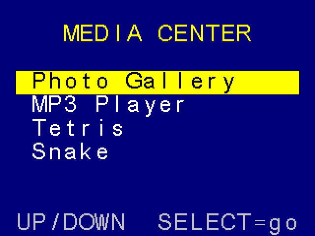</p>
<p align="center"><sub>The unmodified firmware running in the host simulator, with bots playing the games.</sub></p>

Everything runs on a 100 MHz microcontroller with 64 KB of RAM. There's no operating system, frame buffer or graphics library: just a 320×240 SPI LCD, a 5-way joystick, a potentiometer and a speaker. The project is a single firmware image with a joystick-driven menu and four apps.

## On the hardware

<p align="center">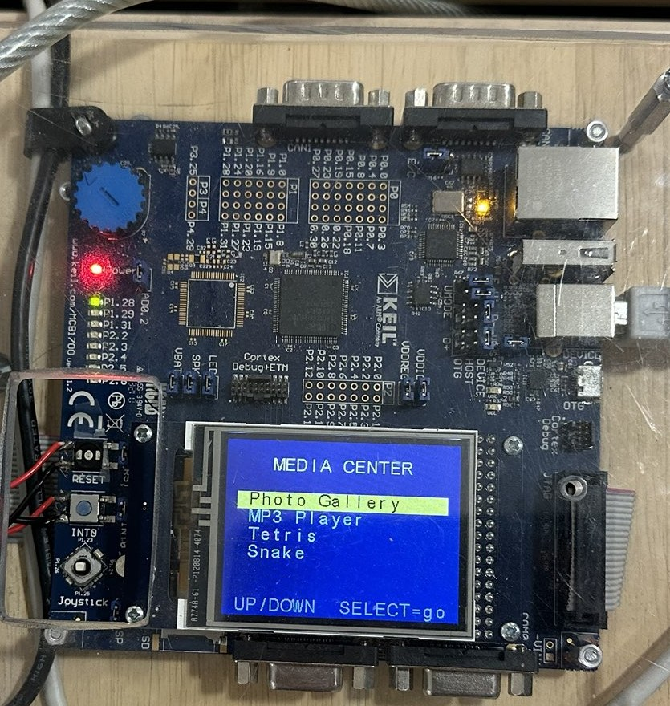</p>

| | |
|---|---|
| 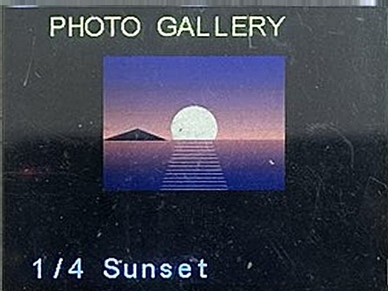 | 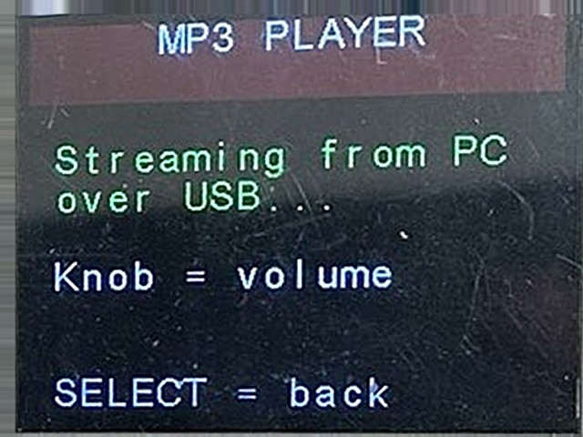 |
| **Photo gallery**: RGB565 images stored in flash, streamed to the LCD one row at a time | **USB audio player**: the board shows up on the PC as a USB speaker ("NXP LPC17xx Speaker"); the knob sets the volume |
| 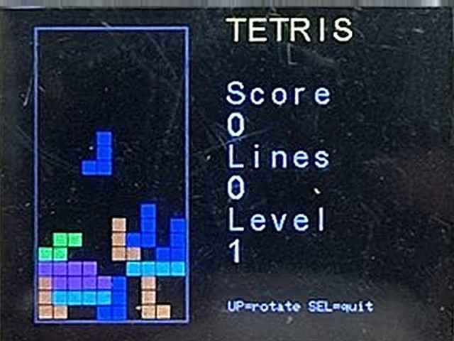 | 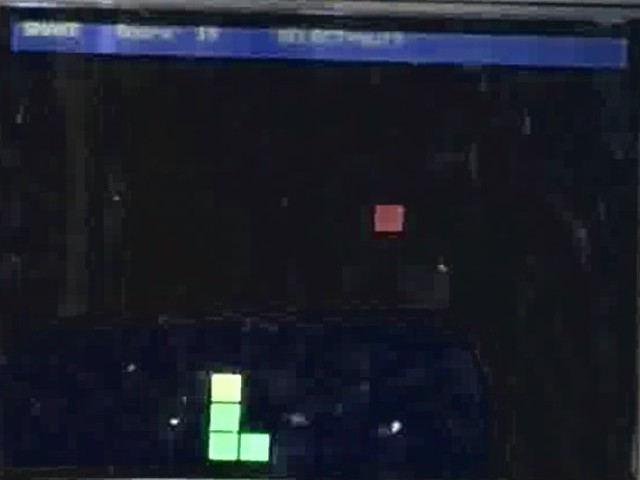 |
| **Tetris**: rotation, wall collision, line clears, scoring and levels that speed up | **Snake**: grows on each apple and gets faster as the score climbs |

<details>
<summary>More screens from the board</summary>

| | |
|---|---|
|  | 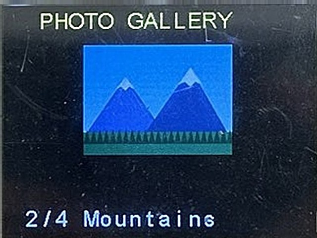 |
| 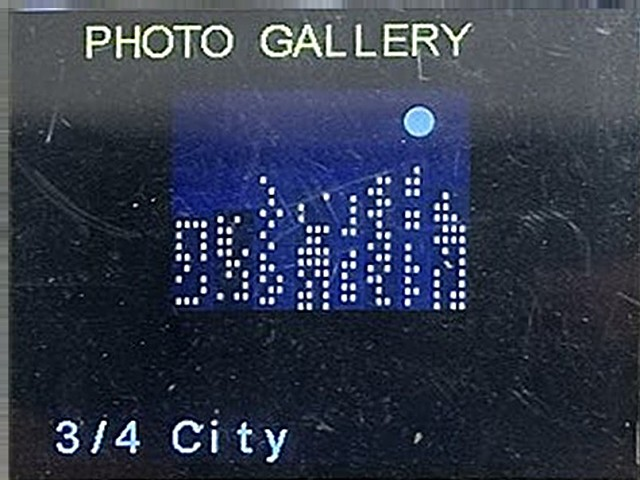 | 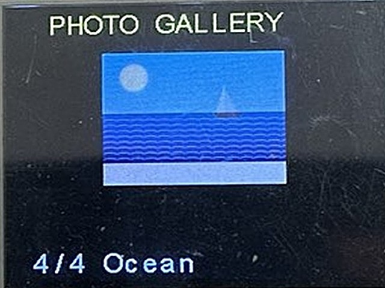 |
| 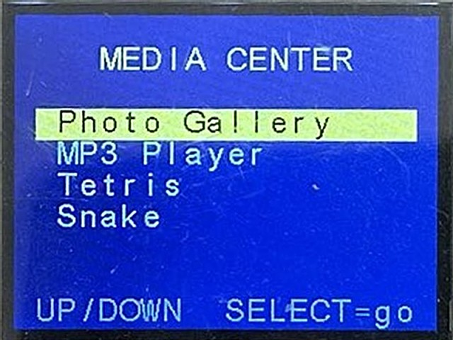 | 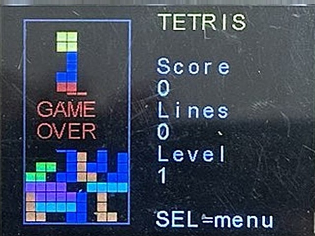 |

</details>

<details>
<summary>Screen renders at the LCD's native 320×240</summary>

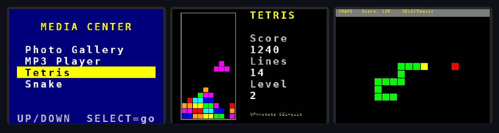

</details>

## By the numbers

| | |
|---|---|
| Flash used | 172 KB of 512 KB (150 KB of it is the four photos; code about 22 KB) |
| RAM used | about 3 KB of 64 KB, including the stack (no frame buffer, no heap) |
| Audio | 32 kHz, 16-bit samples to a 10-bit DAC, one sample every 31.25 µs |
| Time base | 1 ms SysTick |
| Project code | about 480 lines of C, plus the USB stack and board drivers |

## Highlights

- **Bare-metal C on a Cortex-M3.** A 1 ms SysTick time base drives every timer, debounce and game tick. No RTOS, no heap, no dynamic allocation.
- **Partial redraws instead of a frame buffer.** A full frame would need 150 KB of RAM; the chip has 64 KB. The games redraw only the cells that change (a moved piece, the snake's head and tail), so the slow SPI display keeps up.
- **Compact Tetris engine.** Each of the 7 tetrominoes stores its 4 rotations as 16-bit masks of a 4×4 grid; one `fits()` check handles walls, floor and stacked blocks for moves and rotations alike. Scoring follows the classic 40 / 100 / 300 / 1200 table times the level.
- **USB Audio Class streaming.** Audio comes from the PC over USB isochronous transfers into a ring buffer; a timer interrupt fires every 31.25 µs (32 kHz) and writes one sample to the 10-bit DAC, and the ADC reads the potentiometer for volume. Leaving the player disconnects USB and stops the interrupts so the audio stops cleanly and can be re-entered.
- **Image pipeline.** `tools/img2c.py` turns any JPG or PNG into an RGB565 C array, the same format as GIMP's "C source" export, so new photos drop straight into the gallery.

## Testing without the board

The game and UI code is tested on a normal computer. `host/` swaps the board's drivers for fakes: a 320×240 framebuffer for the LCD, scripted joystick input, and a `SIGALRM` timer that plays the part of SysTick. The firmware files in `src/` compile **unchanged**, and CI runs the tests on every push.

```bash
make -C host test
```

| Test file | What it checks |
|---|---|
| `test_input.c` | joystick edge detection (a held button counts once), repeatable random numbers, rectangle fills, the 1 ms delay |
| `test_tetris.c` | all 28 piece rotations, wall/floor/stack collisions, line clears and the 40/100/300/1200 scoring, levels, locking, plus a full game played by a bot that has to clear lines |
| `test_snake.c` | hitting walls, no reversing into itself, apples never spawn on the body, and a bot game where the snake must grow one cell per apple |
| `test_gallery.c` | every photo reaches the screen pixel-for-pixel, upright and not mirrored (the fake LCD copies the real driver's bottom-up bitmap order), and LEFT/RIGHT wrap around |
| `test_highscore.c` | best scores stored in a 256-byte flash page: blank flash reads as zero, only a higher score triggers a write, scores survive a reboot, a finished game records its score |

`make -C host gif FONTS=<path to the LCD_Blinky example>` renders the firmware in the simulator and rebuilds the animation above.

## Optional build flags

| Flag | Add these files | What it does |
|---|---|---|
| `HIGHSCORES` | `highscore.c`, `iap_flash.c` | Keeps the best Tetris and Snake scores in the last flash sector using the LPC1768's IAP routines (prepare, erase, copy 256 bytes), so they survive power-off. Shows "Best" in each game and "NEW BEST" on game over. |
| `PROFILE` | `profile.c` | At boot, times common drawing operations with the Cortex-M3 DWT cycle counter and shows the results in microseconds before the menu. |

Both flags are tested in the simulator; the demo build leaves them off.

## Hardware

| Part | Used for |
|---|---|
| Keil MCB1700 board, NXP LPC1768 (ARM Cortex-M3, 100 MHz, 512 KB flash, 64 KB RAM) | Everything |
| 320×240 colour LCD (SPI) | All graphics |
| 5-way joystick (GPIO) | Navigation and game controls |
| Potentiometer (ADC) | Volume |
| Speaker (DAC) | Audio output |
| USB device port | Audio stream from the PC |
| 8 LEDs (GPIO) | Show the active menu item or app |

## How it works

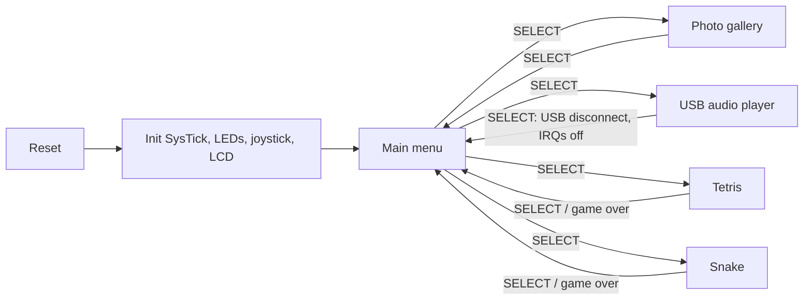

The menu is a simple state machine. Each app takes over the main loop until the user presses SELECT, then hands control back and the menu redraws itself.

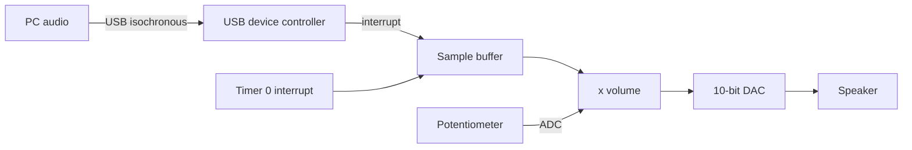

## Controls

| | Menu | Gallery | Tetris | Snake |
|---|---|---|---|---|
| **Up** | Previous item | | Rotate | Turn up |
| **Down** | Next item | | Soft drop | Turn down |
| **Left / Right** | | Previous / next photo | Move (hold to repeat) | Turn |
| **Select** | Open | Back | Quit | Quit |

## Project layout

```
src/
  main.c        menu, SysTick time base, joystick edge detection, drawing helpers
  common.h      shared declarations
  gallery.c     photo carousel (row-by-row bitmap streaming, optional mirroring)
  audio.c       USB audio player screen, clean start and stop
  tetris.c      Tetris engine and renderer
  snake.c       Snake engine and renderer
  photo1-4.c    RGB565 images (160×120)
  highscore.c   best scores, saved through a small flash interface (HIGHSCORES)
  iap_flash.c   that flash interface on the LPC1768, using IAP (HIGHSCORES)
  profile.c     DWT cycle-counter timings at boot (PROFILE)
host/
  fake_hw.c     fake LCD, joystick, LEDs and SysTick for running the firmware on a PC
  test_*.c      unit and gameplay tests
  sim.c         renders the firmware to frames for the demo animation
tools/
  img2c.py      JPG/PNG to RGB565 C array converter
  make_gif.py   turns simulator frames into a GIF
docs/img/       screenshots and source images
```

## Building

1. Start from Keil's **USBAudio** example for the MCB1700 (USB stack, startup code, clock setup and the DMA scatter file that places USB buffers in AHB RAM). If µVision 5 asks, choose **Migrate to Device Pack**.
2. Copy in the board's LCD, joystick and LED drivers (`GLCD_SPI_LPC1700.c`, `GLCD.h`, the two font headers, `KBD.c/.h`, `LED.c/.h`).
3. In the example's `usbdmain.c`, rename `main()` to `audio_start()` and delete its final `while (1);`, so the menu can start the audio player and get control back.
4. Add the files in `src/` to the project **except** `photo*.c` (`gallery.c` includes those directly).
5. Build and flash with Keil µVision (F7, then F8). In a VMware lab setup, connect "NXP LPC17xx Speaker" to the VM under *Removable Devices* while the MP3 player is open.

The Keil/NXP example and driver code isn't included here; only the code written for this project is.

### Adding your own photos

```bash
pip install pillow
python tools/img2c.py my_picture.jpg photo1          # writes photo1.c (160×120, RGB565)
python tools/img2c.py my_picture.jpg photo1 --flip   # mirrored, if your LCD draws it backwards
```

## Built with

C (C89), Keil µVision 5 and the ARM compiler, CMSIS; GCC, Make and GitHub Actions for the host tests; Python and Pillow for the image tools.

---

Built for COE718 Embedded Systems Design at Toronto Metropolitan University by **Ridham Aggarwal**.
